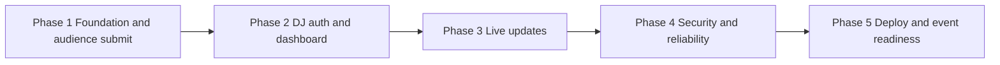

# DJ Night Song Request — Atomic Task Plan

Source: `dj_dashboard_PRD.md` (MVP v1.0).  
Scope: one event, one shared queue, up to 100 attendees, SQLite file as the source of truth.

This file is the implementation backlog. Build the smallest application that satisfies the PRD. Do not add accounts, voting, payments, song search, playback, analytics, backups, Redis, brokers, or extra services.

## Rules

1. Complete phases in order: 1 → 2 → 3 → 4 → 5. Do not start a phase until the previous phase exit task is done.
2. Inside a phase, tasks are listed in a valid sequential order. Start a task only after every ID in **Depends on** is done.
3. A task is atomic: one outcome, one verification, no extra features. Leave the app runnable when the task is done.
4. Mark a task done by changing `- [ ]` to `- [x]` only after its **Done when** checks pass.
5. SQLite is the queue source of truth. Do not keep the queue only in memory or in the browser.
6. Return submission success only after the database transaction commits.
7. Keep secrets out of source control, frontend bundles, logs, and API errors.
8. If a task must deviate from the PRD, record the deviation and the reason in the task notes before continuing.

## Locked stack

Decide nothing later that contradicts this. Record exact versions in the README (`T1.22`).

| Area | Choice |
| --- | --- |
| Runtime | Node.js 22 |
| Layout | npm workspaces: `apps/api`, `apps/web` |
| API | Express + TypeScript |
| Database | `better-sqlite3`, file path from `DATABASE_PATH` (never `:memory:`) |
| Validation | `zod` on the server; client checks are hints only |
| Web | Vite + React + TypeScript |
| Auth | Server session row in SQLite, `HttpOnly` cookie, scrypt password hash |
| Live updates | Authenticated Server-Sent Events |
| IDs / time | `crypto.randomUUID()`, UTC ISO-8601 strings |
| Tests | Node.js built-in test runner for API and integration |

Production serves the built web app from the API so the session cookie and SSE stay on one origin.

## Environment variables

Use these names in code, `.env.example`, and the README. Example files contain placeholders only.

| Name | Introduced | Purpose |
| --- | --- | --- |
| `PORT` | T1.03 | API listen port |
| `NODE_ENV` | T1.03 | `development` or `production` |
| `DATABASE_PATH` | T1.03 | SQLite file path, default `./data/dj-requests.sqlite` |
| `PUBLIC_BASE_URL` | T1.03 | Stable audience origin encoded by the QR code |
| `EVENT_TITLE` | T1.03 | Public event or DJ branding title |
| `DJ_PASSWORD_HASH` | T1.03 | scrypt hash of the DJ password; verified in T2.01 |
| `SESSION_SECRET` | T1.03 | Secret used to sign the session cookie |
| `SESSION_TTL_HOURS` | T1.03 | Session lifetime; default 12 |
| `SUBMISSION_RATE_LIMIT_MAX` | T4.01 | Max public submits per window |
| `SUBMISSION_RATE_LIMIT_WINDOW_MS` | T4.01 | Submit window length |
| `LOGIN_RATE_LIMIT_MAX` | T4.02 | Max failed logins per window |
| `LOGIN_RATE_LIMIT_WINDOW_MS` | T4.02 | Login window length |

## Phase map



| Phase | Goal | Exit task |
| --- | --- | --- |
| 1 | Attendee can submit a request that commits to SQLite; QR encodes the audience URL | T1.23 |
| 2 | DJ can log in, see the queue in sequence order, and mark played or skipped | T2.19 |
| 3 | Dashboard updates without a manual refresh and reloads from SQLite on reconnect | T3.08 |
| 4 | Rate limits, concurrency, safe rendering, and failure behavior are verified | T4.15 |
| 5 | Documented deploy, printed QR, and a representative 100-attendee test | T5.10 |

## Error contract

All API errors use this shape and nothing else (no stack, SQL, paths, or secrets):

```json
{
  "error": {
    "code": "VALIDATION_ERROR",
    "message": "Please provide a song title."
  }
}
```

Codes used by later tasks: `VALIDATION_ERROR` (400), `RATE_LIMITED` (429), `UNAUTHENTICATED` (401), `FORBIDDEN` (403), `NOT_FOUND` (404), `CONFLICT` (409), `PERSISTENCE_ERROR` (500), `SERVICE_UNAVAILABLE` (503).

---

## Phase 1 — Foundation and audience submission

Audience submission works end to end. Requests live in SQLite. The QR code points at the public page.

### T1.01 — Scaffold the workspace

- **Depends on:** —
- **Priority:** P0
- **Traces:** NFR-010

**Do**

- Create `apps/api` and `apps/web` npm workspaces with TypeScript.
- API: Express entry that listens on `PORT`.
- Web: Vite + React app with a single placeholder route.
- Add `.gitignore` for `node_modules`, `dist`, `.env`, and `data/*.sqlite*`.
- Add `.env.example` with the Phase 1 variable names and empty or placeholder values.

**Done when**

- [x] `npm install` at the repo root succeeds.
- [x] API process starts and web dev server starts.
- [x] No secret values are committed.

### T1.02 — Add root scripts

- **Depends on:** T1.01
- **Priority:** P0
- **Traces:** NFR-010

**Do**

- Root scripts: `dev`, `build`, `test`, `start`.
- `dev` runs API and web together.
- `build` compiles the API and builds the web app.
- `test` runs the API test runner (empty suite is acceptable until T1.21).

**Done when**

- [x] Each script exists and exits 0 on a clean tree (`test` may have zero tests).

### T1.03 — Load and validate environment

- **Depends on:** T1.01
- **Priority:** P0
- **Traces:** FR-027, FR-028, NFR-010

**Do**

- Parse `PORT`, `NODE_ENV`, `DATABASE_PATH`, `PUBLIC_BASE_URL`, `EVENT_TITLE`, `DJ_PASSWORD_HASH`, `SESSION_SECRET`, `SESSION_TTL_HOURS` at startup.
- Fail startup with a clear log if a required value is missing or `PUBLIC_BASE_URL` is not an absolute `http`/`https` URL.
- Default `DATABASE_PATH` to `./data/dj-requests.sqlite` and `SESSION_TTL_HOURS` to `12`.
- Do not print secret values.

**Done when**

- [x] Missing `SESSION_SECRET` or `DJ_PASSWORD_HASH` prevents startup.
- [x] A valid `.env` loads the typed config object.
- [x] Tests can inject config without reading a developer `.env`.

### T1.04 — Open the SQLite file

- **Depends on:** T1.03
- **Priority:** P0
- **Traces:** FR-044, NFR-004

**Do**

- Open `better-sqlite3` on `DATABASE_PATH`.
- Create the parent directory if it is missing.
- Set `journal_mode = WAL` and `foreign_keys = ON`.
- Refuse a path of `:memory:`.

**Done when**

- [x] Startup creates the parent directory and the database file on disk.
- [x] A second startup opens the same file.

### T1.05 — Add a request repository boundary

- **Depends on:** T1.04
- **Priority:** P0
- **Traces:** FR-045, FR-055, FR-057

**Do**

- Add a `SongRequestRepository` module that owns every SQL statement for `song_requests`.
- HTTP handlers must not embed SQL.
- All statements are parameterized.

**Done when**

- [x] Route modules import repository functions only.
- [x] A search of route files shows no SQL strings.

### T1.06 — Create the schema

- **Depends on:** T1.05
- **Priority:** P0
- **Traces:** FR-015, FR-022, FR-044, FR-051

**Do**

- Apply `CREATE TABLE IF NOT EXISTS` for `song_requests` and the two indexes from PRD §10.1, including nullable unique `idempotency_key`.
- Store `created_at` and `updated_at` as UTC ISO-8601 text.
- Running migration twice must not drop, truncate, or rewrite existing rows.

**Done when**

- [x] Fresh file contains the table and both indexes.
- [x] A second startup leaves inserted rows unchanged.
- [x] `status` rejects values other than `pending`, `played`, and `skipped` at the database.

### T1.07 — Initialize a missing database without wiping a valid one

- **Depends on:** T1.06
- **Priority:** P0
- **Traces:** FR-051, FR-052, T-021, T-022

**Do**

- If the file is absent, create it and apply the schema.
- Log one explicit line that a new database was created and prior requests were not recovered.
- If the file exists and the schema is present, do not delete rows and do not log a recovery claim.
- If the file exists but is not a usable database, fail startup with a safe message. Do not delete the file automatically.

**Done when**

- [x] Deleting the file, then starting, yields an empty schema and the non-recovery log line.
- [x] Starting with an existing row leaves that row in place.

### T1.08 — Standardize API errors

- **Depends on:** T1.01
- **Priority:** P0
- **Traces:** FR-061, §11, §15

**Do**

- Add one error helper that emits the JSON contract and HTTP status.
- Unhandled errors become `PERSISTENCE_ERROR` or `SERVICE_UNAVAILABLE` with a generic message.
- Response bodies never include `stack`, SQL, file paths, or config values.

**Done when**

- [x] A thrown error in a test route returns the JSON contract only.
- [x] The response body does not contain the exception stack.

### T1.09 — Validate song-request input

- **Depends on:** T1.01
- **Priority:** P0
- **Traces:** FR-004, FR-005, FR-006, FR-007, FR-056, FR-063

**Do**

- Accept JSON: `requesterName` (required), `songTitle` (required), `artistName` (optional), `idempotencyKey` (optional string, stored later).
- Trim strings. Reject empty required fields after trim.
- Limits: name 1–80, song title 1–160, artist 0–160. Blank artist becomes `null`.
- Reject non-strings, extra unexpected types, and over-long input.
- Collect no other personal data.

**Done when**

- [x] Unit tests cover missing name, missing title, omitted artist, blank artist → `null`, over-long fields, and non-string types.
- [x] Validation does not touch the database.

### T1.10 — Insert a request in one transaction

- **Depends on:** T1.06, T1.09
- **Priority:** P0
- **Traces:** FR-014, FR-015, FR-016, FR-017, FR-020, FR-049, NFR-005

**Do**

- In `BEGIN IMMEDIATE`: compute `MAX(sequence_number) + 1` (or `1` if empty), insert one row with UUID, UTC timestamps, and `status = 'pending'`, then commit.
- Sequence assignment and insert share one transaction.
- On any failure, roll back and throw. Leave no partial row.
- Uniqueness of `sequence_number` stays enforced by the schema.
- Document in a short code comment that arrival order is successful commit order, not tap time.

**Done when**

- [x] One valid insert commits a row with id, sequence, timestamps, and `pending`.
- [x] A forced failure before commit leaves the table unchanged and does not consume a visible sequence.
- [x] Two sequential inserts receive sequence `1` then `2`.

### T1.11 — `POST /api/requests`

- **Depends on:** T1.08, T1.10
- **Priority:** P0
- **Traces:** FR-009, FR-014, FR-050, §11.1, T-001, T-002, T-003, T-004, T-005

**Do**

- Public route. No session required.
- `400 VALIDATION_ERROR` for invalid input, before any insert.
- `201` with the PRD request object only after commit. Include `artistName: null` when artist was omitted.
- Map database failures to `500`/`503` and do not return the success body.
- Ignore idempotency behavior until T4.04; accept and store the key if present, without deduplicating yet.

**Done when**

- [x] Valid body returns `201` and exactly one row.
- [x] Missing name or title returns `400` and zero new rows.
- [x] Omitted artist persists as `NULL`.
- [x] A simulated write failure returns a non-2xx body and no success payload.

### T1.12 — `GET /api/health`

- **Depends on:** T1.07, T1.08
- **Priority:** P0
- **Traces:** §11.2

**Do**

- Return a minimal public payload such as `{ "status": "ok" }` when the process and a trivial DB probe succeed.
- On probe failure return `{ "status": "error" }` with `503`.
- Do not return file paths, versions of secrets, row counts, or config.

**Done when**

- [x] Healthy process returns `200` and the minimal body.
- [x] Response JSON has no path or secret fields.

### T1.13 — Log requests without secrets

- **Depends on:** T1.08
- **Priority:** P0
- **Traces:** FR-028, NFR-012

**Do**

- Log method, path, status, and duration.
- Never log request bodies, passwords, cookies, `SESSION_SECRET`, `DJ_PASSWORD_HASH`, or session ids.
- Log persistence failures with a safe reason category, not SQL or the file path.

**Done when**

- [x] A test or log review of `POST /api/requests` shows no body and no cookie value.

### T1.14 — Scaffold the web app shell

- **Depends on:** T1.01
- **Priority:** P0
- **Traces:** FR-002, NFR-006

**Do**

- Add a mobile-first base layout: readable type, viewport meta, no fixed wide containers.
- Router paths reserved: `/` audience, `/dj` dashboard (placeholder until Phase 2).
- Render text as React text, never `dangerouslySetInnerHTML`.

**Done when**

- [x] `/` renders in the Vite dev server.
- [x] `/dj` renders a placeholder without calling DJ APIs.

### T1.15 — Proxy API calls in development

- **Depends on:** T1.02, T1.14
- **Priority:** P0
- **Traces:** §9.1

**Do**

- Proxy `/api` from the Vite dev server to the API.
- Document that production will serve `apps/web/dist` from the API on the same origin (implemented in T5.01).

**Done when**

- [x] The browser can call `/api/health` through the dev server and get the API response.

### T1.16 — `GET /api/config`

- **Depends on:** T1.03, T1.08
- **Priority:** P0
- **Traces:** §10.3, §13.1

**Do**

- Public route returning `{ "eventTitle": "<EVENT_TITLE>" }` only.
- Do not return the password hash, session secret, database path, or admin URLs.

**Done when**

- [x] Response contains `eventTitle` and no other keys.

### T1.17 — Audience page structure

- **Depends on:** T1.14, T1.16
- **Priority:** P0
- **Traces:** FR-001, FR-003, §13.1

**Do**

- `/` shows the event title from `GET /api/config`.
- Page is public. No login, no account link, no DJ password field.
- If config fails, show a short retry message and still allow the form to be attempted.

**Done when**

- [x] Opening `/` does not require a cookie.
- [x] Event title from the API is visible.

### T1.18 — Audience request form

- **Depends on:** T1.17
- **Priority:** P0
- **Traces:** FR-004, FR-005, FR-006, NFR-008

**Do**

- Fields: requester name, song title, optional artist, submit button.
- Each control has a visible `<label>`, an accessible name, and a visible focus style.
- Client-side `maxLength` and `required` match server limits but are not the authority.

**Done when**

- [x] Keyboard-only users can reach every field and the button.
- [x] Artist can be left empty.

### T1.19 — Submit, loading, success, and failure states

- **Depends on:** T1.11, T1.18
- **Priority:** P0
- **Traces:** FR-008, FR-009, FR-010, FR-011, FR-013, T-006

**Do**

- On submit, disable the button and show a loading state until the response arrives.
- On `201` only: show success, then clear the form.
- On `400`: show the server message and keep the entered values.
- On network failure, `429`, `500`, or `503`: show an actionable error and keep the values. Never show success.
- Ignore extra clicks while the request is in flight.

**Done when**

- [x] A successful submit shows confirmation only after `201` and clears the fields.
- [x] A `400` leaves the typed values in the form.
- [x] A failed fetch does not show the success state.
- [x] The button does not fire a second request while the first is pending.

### T1.20 — Generate a static audience QR code

- **Depends on:** T1.03
- **Priority:** P0
- **Traces:** FR-038, FR-039, FR-040, FR-041, FR-042, T-019

**Do**

- Add an npm script that writes a PNG (and a printable SVG if cheap) encoding `PUBLIC_BASE_URL` plus the audience path `/`.
- Payload is the URL only: no tokens, request ids, or session data.
- Script reads env and does not start the DJ route.
- Output path is gitignored (for example `data/qr-audience.png`).

**Done when**

- [x] Running the script prints the encoded URL and writes the image.
- [x] Decoding the payload equals the configured audience URL and not `/dj`.

### T1.21 — Phase 1 automated tests

- **Depends on:** T1.07, T1.11, T1.12, T1.20
- **Priority:** P0
- **Traces:** T-001, T-002, T-003, T-004, T-005, T-007, T-015, T-017, T-019, T-021, T-022, NFR-004

**Do**

- Use a temporary database file per test.
- Cover: valid create; missing name; missing title; artist omitted; over-long input; write failure has no `201`; rows remain after reopening the same file; missing file initializes empty; existing file is not cleared; QR payload is the audience URL.

**Done when**

- [x] `npm test` passes these cases.
- [x] Tests do not depend on a developer’s real `data/` database.

### T1.22 — Baseline README

- **Depends on:** T1.21
- **Priority:** P0
- **Traces:** FR-043, FR-053, FR-054, NFR-010, NFR-013, §18, §18.1

**Do**

- Document prerequisites, install, `dev`, `test`, `build`, env vars, SQLite path, and first-run behavior.
- State what survives (refresh and process restart while the file remains) and what does not (redeploy, container replacement, file deletion).
- State that backups and replication are out of scope.
- Document the QR script and that changing `PUBLIC_BASE_URL` requires a new QR code unless a stable redirect is kept.
- Include a hash-generation command for `DJ_PASSWORD_HASH` using scrypt parameters that T2.01 will verify. Do not include a real password.

**Done when**

- [x] A clean setup can be followed from the README through one successful `POST /api/requests`.
- [x] Data-loss limits and the QR URL rule are present.

### T1.23 — Phase 1 exit

- **Depends on:** T1.13, T1.15, T1.19, T1.22
- **Priority:** P0
- **Traces:** Phase 1 exit criteria

**Do**

- Run `npm test`.
- Manually submit one request from the audience page, refresh the browser, restart the API, and confirm the row is still in SQLite.
- Confirm the QR payload opens `/` rather than `/dj`.

**Done when**

- [x] Automated tests pass.
- [x] Manual submit → refresh → API restart still shows the row in the database.
- [x] The UI never shows success when the API returns an error.

---

## Phase 2 — DJ authentication and queue dashboard

The DJ logs in with the shared password, reads the persisted queue in sequence order, and marks requests played or skipped.

### T2.01 — Verify the DJ password

- **Depends on:** T1.23
- **Priority:** P0
- **Traces:** FR-027, FR-028, FR-029, §12

**Do**

- Verify `password` with `crypto.scrypt` against `DJ_PASSWORD_HASH`.
- Use a constant-time compare.
- Store only the hash in env. Never return or log the password or the hash.
- Ship the hash format in the README command from T1.22 (algorithm, salt, params).

**Done when**

- [x] Unit test: correct password passes; wrong password fails.
- [x] Logs from the test do not contain the password.

### T2.02 — Store sessions in SQLite

- **Depends on:** T1.06
- **Priority:** P0
- **Traces:** FR-029, FR-030, FR-031

**Do**

- Add `sessions` via `CREATE TABLE IF NOT EXISTS`: `id` (primary key), `csrf_token`, `created_at`, `expires_at`.
- Repository methods: create, read unexpired, delete by id, delete expired.
- Do not store the password in this table.

**Done when**

- [x] Migration is idempotent and does not touch `song_requests` rows.
- [x] An expired row is not treated as a valid session.

### T2.03 — Create the session cookie

- **Depends on:** T2.01, T2.02
- **Priority:** P0
- **Traces:** FR-029, FR-031, §12

**Do**

- On successful password check, create a `crypto.randomBytes` session id and CSRF token, persist expiry from `SESSION_TTL_HOURS`, and set cookie `dj_session`.
- Cookie flags: `HttpOnly`, `SameSite=Lax`, `Path=/`, `Secure` when `NODE_ENV=production`.
- Sign the cookie with `SESSION_SECRET`. The raw session id in the cookie is an opaque identifier; authorization still loads the SQLite row.

**Done when**

- [x] Login helper sets a cookie the browser JS cannot read (`HttpOnly`).
- [x] A session past `expires_at` is rejected.

### T2.04 — Issue a CSRF token

- **Depends on:** T2.03
- **Priority:** P0
- **Traces:** FR-062, §12

**Do**

- Return `csrfToken` in the login JSON body and from the session probe. Do not put it in a non-HttpOnly cookie.
- Mutating authenticated routes require header `X-CSRF-Token` matching the session row.
- Mismatch returns `403` with code `FORBIDDEN` and performs no write.

**Done when**

- [x] A status change without the header is rejected and does not change the row.
- [x] The same call with the matching header is accepted once T2.10 exists; until then, cover the check with a test-only mutating route or wait and satisfy this in T2.10’s tests. This task must land the check before T2.10.

### T2.05 — `POST /api/auth/login`

- **Depends on:** T2.03, T2.04, T1.08
- **Priority:** P0
- **Traces:** FR-029, §11.3, T-010, T-011

**Do**

- Body: `{ "password": "..." }`.
- Success: `200`, set cookie, body `{ "csrfToken": "..." }` only.
- Failure: `401` with a generic message that does not say whether the hash is missing or the password was close.
- Rate limiting is T4.02; do not add it here.

**Done when**

- [x] Correct password sets the cookie and returns a CSRF token.
- [x] Wrong password returns `401`, no cookie, and no session row.
- [x] Response never contains the password or hash.

### T2.06 — `POST /api/auth/logout`

- **Depends on:** T2.04, T2.05
- **Priority:** P0
- **Traces:** FR-030, §11.4

**Do**

- Require a valid session and CSRF header.
- Delete the session row and clear the cookie.
- Already logged-out callers receive `401`.

**Done when**

- [x] After logout, the old cookie cannot call `GET /api/dj/requests` (assert fully when T2.09 is in place; this task deletes the row and clears the cookie).

### T2.07 — `GET /api/auth/session`

- **Depends on:** T2.03
- **Priority:** P0
- **Traces:** §11.5

**Do**

- `{ "authenticated": false }` when no valid session.
- `{ "authenticated": true, "csrfToken": "..." }` when valid.
- No password, hash, session id, or expiry secrets beyond the CSRF token the SPA must echo.

**Done when**

- [x] Unauthenticated call returns `authenticated: false` with `200`.
- [x] Authenticated call returns the CSRF token and no session id.

### T2.08 — Require a DJ session on protected routes

- **Depends on:** T2.03
- **Priority:** P0
- **Traces:** FR-026, FR-033, NFR-007

**Do**

- Middleware loads the session from the cookie and SQLite.
- Missing, invalid, or expired session returns `401 UNAUTHENTICATED`.
- Apply it to every `/api/dj/*` route and to logout.
- Hiding buttons is not a substitute for this check.

**Done when**

- [x] A probe protected route returns `401` without a cookie and `200` with a live session.

### T2.09 — `GET /api/dj/requests`

- **Depends on:** T2.08, T1.06
- **Priority:** P0
- **Traces:** FR-018, FR-019, FR-048, §11.6, T-009, T-012

**Do**

- Return every request ordered by `sequence_number ASC`.
- Shape matches PRD §11.6, including `updatedAt` and `artistName` (`null` when empty).
- No pagination.
- Unauthenticated calls get `401` and an empty error body (no queue data).

**Done when**

- [x] Order is sequence order even if insert timestamps are equal.
- [x] No cookie returns `401` and does not include request titles.

### T2.10 — `PATCH /api/dj/requests/:id/status`

- **Depends on:** T2.04, T2.08, T2.09
- **Priority:** P0
- **Traces:** FR-021, FR-034, FR-035, FR-036, §11.7, T-013, T-014

**Do**

- Body `{ "status": "played" }` or `{ "status": "skipped" }`.
- Require session and CSRF.
- `404` if id is missing. `400` if status is anything else, including `pending`.
- Update `status` and `updated_at` only. Do not change `sequence_number` or identity fields.
- Return the updated request.

**Done when**

- [x] Played and skipped persist and keep the original sequence.
- [x] `pending` and unknown statuses are rejected.
- [x] Unauthenticated and CSRF-missing calls do not write.

### T2.11 — DJ login page

- **Depends on:** T1.14, T2.05
- **Priority:** P0
- **Traces:** §13.2, NFR-008

**Do**

- `/dj` shows a password field, submit button, and loading state while login is in flight.
- Failed login shows one generic message.
- Accessible label, keyboard submit, visible focus.
- Store the returned `csrfToken` in memory for later mutating calls (module state or React context, not `localStorage`).

**Done when**

- [x] Correct password leaves the login form.
- [x] Wrong password shows the generic error and stays on the form.

### T2.12 — Gate the dashboard on the session

- **Depends on:** T2.07, T2.11
- **Priority:** P0
- **Traces:** FR-025, FR-026

**Do**

- On `/dj` load, call `GET /api/auth/session`.
- Authenticated: render the dashboard shell.
- Otherwise: render the login page.
- A `401` from any DJ call returns the user to the login page.

**Done when**

- [x] Refresh with a live cookie opens the dashboard without asking for the password again.
- [x] Refresh without a cookie shows login, not queue data.

### T2.13 — Dashboard shell

- **Depends on:** T2.06, T2.12
- **Priority:** P0
- **Traces:** §13.3

**Do**

- Show event title, pending count, and a logout button.
- Logout calls `POST /api/auth/logout` with `X-CSRF-Token`, then shows the login page.
- Connection-status widget is a static “not live yet” label until T3.05. Do not poll yet.

**Done when**

- [x] Logout removes access until the password is entered again.
- [x] Pending count matches rows with `status = pending` from the API.

### T2.14 — Pending queue list

- **Depends on:** T2.09, T2.13
- **Priority:** P0
- **Traces:** FR-018, FR-019, T-009

**Do**

- Load `GET /api/dj/requests` when the dashboard mounts.
- Pending section lists `pending` rows in sequence order.
- Each row shows sequence, song, artist when present, requester, timestamp, and status text.

**Done when**

- [x] Display order matches `sequenceNumber` ascending.
- [x] A row with `artistName: null` omits the artist rather than showing `"null"`.

### T2.15 — Played and skipped history

- **Depends on:** T2.14
- **Priority:** P0
- **Traces:** FR-021, FR-023

**Do**

- Show non-pending rows in a history section, still ordered by sequence ascending (not by update time).
- Keep them visible after status changes. Do not delete them from the UI or the database.

**Done when**

- [x] Marking a row played moves it to history and leaves the sequence numbers of other rows unchanged.

### T2.16 — Played and skipped actions

- **Depends on:** T2.10, T2.14
- **Priority:** P0
- **Traces:** FR-034, FR-035, §13.3

**Do**

- Pending rows have Played and Skipped actions.
- Send `PATCH` with the CSRF header.
- Disable that row’s actions while the patch is in flight.
- On success, replace the row from the response.
- On failure, show an error and leave the prior status on screen.

**Done when**

- [x] A double-click does not send two patches.
- [x] After refresh, the new status is still loaded from `GET /api/dj/requests`.

### T2.17 — Dashboard loading, empty, and error states

- **Depends on:** T2.14
- **Priority:** P0
- **Traces:** FR-024, §13.3

**Do**

- Loading: visible progress text while the first fetch runs.
- Empty: explicit copy when the queue has zero rows.
- Error: message plus retry that calls `GET /api/dj/requests` again.
- Do not render a fake empty queue while the first load is still failing.

**Done when**

- [x] New database shows the empty state.
- [x] A failed list request shows the error and retry, not an empty queue.

### T2.18 — Phase 2 automated tests

- **Depends on:** T2.05, T2.06, T2.09, T2.10
- **Priority:** P0
- **Traces:** T-009, T-010, T-011, T-012, T-013, T-014, T-016, NFR-007

**Do**

- Cover login success, login failure, unauthenticated list, unauthenticated patch, CSRF rejection, played, skipped, sequence unchanged, logout then `401`, and list order.

**Done when**

- [x] `npm test` passes Phase 1 and Phase 2 cases.

### T2.19 — Phase 2 exit

- **Depends on:** T2.15, T2.16, T2.17, T2.18
- **Priority:** P0
- **Traces:** Phase 2 exit criteria

**Do**

- Run `npm test`.
- Manually: submit two audience requests, log in, confirm order, mark one played and one skipped, refresh, confirm both statuses and the original order.

**Done when**

- [x] Queue content on screen matches SQLite after refresh.
- [x] Logged-out and never-logged-in API calls cannot read or change the queue.

---

## Phase 3 — Live updates and reconnect

New requests and status changes appear on an open dashboard without a manual refresh. SQLite remains the authority if an event is missed.

### T3.01 — `GET /api/dj/requests/stream`

- **Depends on:** T2.19
- **Priority:** P0
- **Traces:** FR-037, §11.8, §14

**Do**

- Authenticated SSE endpoint. `401` without a session.
- Headers: `Content-Type: text/event-stream`, no buffering proxies assumed; disable response buffering where Express allows it.
- Send a comment heartbeat on an interval so proxies do not idle-close the stream. Clear the interval on disconnect.
- Do not accept this route as a substitute for the snapshot GET.

**Done when**

- [x] A logged-in client receives the response headers and a heartbeat.
- [x] An anonymous client receives `401` and no stream.

### T3.02 — Publish events only after commit

- **Depends on:** T1.11, T2.10, T3.01
- **Priority:** P0
- **Traces:** §9.4, §14

**Do**

- In-process listener list. After a successful request insert or status commit, emit the committed row.
- If the transaction rolls back, emit nothing.
- Emitting must not insert a second database row.
- If no dashboard is connected, the commit still succeeds.

**Done when**

- [x] A commit with zero listeners still returns `201` or the patch result.
- [x] A failed transaction produces no event.

### T3.03 — SSE event contract

- **Depends on:** T3.02
- **Priority:** P0
- **Traces:** §14, NFR-003

**Do**

- On connect, send one `snapshot` event whose data is the full queue ordered by sequence (same payload as the list endpoint).
- After that, send `request.created` or `request.updated` with the single committed row.
- Events are hints. They are not the stored copy.

**Done when**

- [x] A client that connects after two rows exist receives both rows in the snapshot before any later event.
- [x] Event payloads use the public request shape, not raw SQL rows with extra columns.

### T3.04 — Dashboard live client

- **Depends on:** T2.14, T3.03
- **Priority:** P0
- **Traces:** §14, NFR-003

**Do**

- While the dashboard is mounted and authenticated, open `EventSource` on the stream URL with credentials/cookies.
- Apply `snapshot` by replacing local state.
- Apply create/update by upserting on `id`.
- Always sort pending and history by `sequenceNumber` ascending.
- Never POST a request because an SSE event arrived.

**Done when**

- [x] Submitting from a second client adds one pending row on the open dashboard without a reload.
- [x] The same id cannot appear twice.

### T3.05 — Connection status

- **Depends on:** T3.04
- **Priority:** P0
- **Traces:** FR-037, §13.3, §14

**Do**

- Visible text status: `connected`, `reconnecting`, or `offline`.
- Status is a word, not color alone.
- `EventSource` errors move the UI to `reconnecting`. Give up to `offline` after repeated failure (document the retry count in code).

**Done when**

- [x] Stopping the API while the dashboard is open changes the status text.
- [x] The queue already on screen stays visible during reconnect.

### T3.06 — Reload from SQLite on reconnect

- **Depends on:** T2.09, T3.04, T3.05
- **Priority:** P0
- **Traces:** FR-048, NFR-009, §14, T-018

**Do**

- When the stream opens again, trust the next `snapshot` as a full replace.
- Also call `GET /api/dj/requests` if the stream errors before a snapshot arrives, and replace local state with that list.
- A missed event must disappear once the snapshot or GET result is applied.

**Done when**

- [x] Inserts made while the stream is down appear after reconnect, in sequence order, with no duplicates.
- [x] Status changes made while the stream is down match SQLite after reconnect.

### T3.07 — Phase 3 automated tests

- **Depends on:** T3.02, T3.03, T3.06
- **Priority:** P0
- **Traces:** T-018, NFR-003, NFR-009

**Do**

- API tests: stream requires auth; snapshot contains committed rows; create emits one event; failed insert emits none; a second connection does not duplicate rows in SQLite.
- Client merge can be a pure function test: snapshot replace, upsert, sort, dedupe by id.

**Done when**

- [x] `npm test` passes Phase 1–3 cases.
- [x] Tests assert row counts in SQLite, not only event counts.

### T3.08 — Phase 3 exit

- **Depends on:** T3.05, T3.07
- **Priority:** P0
- **Traces:** Phase 3 exit criteria

**Do**

- With the dashboard open, submit a request from the audience page and confirm it appears without a manual refresh (target: within 2 seconds on localhost).
- Stop the API or disconnect the stream, submit another request, restore the connection, and confirm the full queue matches SQLite.

**Done when**

- [x] Live insert appears automatically under normal local conditions.
- [x] Reconnect reloads authoritative order and status.
- [x] SQLite row count equals the distinct rows shown after reconnect.

---

## Phase 4 — Security, reliability, and UX hardening

Close abuse, concurrency, rendering, and failure gaps. P1 items in this phase are part of the MVP hardening bar in the PRD.

### T4.01 — Rate-limit public submissions

- **Depends on:** T3.08
- **Priority:** P1
- **Traces:** FR-059, T-020, NFR-001

**Do**

- In-memory fixed window per client IP using `SUBMISSION_RATE_LIMIT_MAX` and `SUBMISSION_RATE_LIMIT_WINDOW_MS`.
- Over-limit `POST /api/requests` returns `429 RATE_LIMITED` and writes no row.
- Document that counters reset on process restart and are per API process.
- Choose defaults suitable for a 100-person event (document the numbers). Do not block a single legitimate retry burst of a few requests.

**Done when**

- [x] Requests under the limit still return `201`.
- [x] The next request in the window returns `429` and does not insert.

### T4.02 — Rate-limit failed logins

- **Depends on:** T2.05, T4.01
- **Priority:** P1
- **Traces:** FR-032, FR-060, T-020

**Do**

- Count failed password attempts per IP with `LOGIN_RATE_LIMIT_MAX` and `LOGIN_RATE_LIMIT_WINDOW_MS`.
- Over limit: `429` and no session, including if a later password in the window is correct.
- Successful login clears that IP’s failure count.
- Do not log the attempted password.

**Done when**

- [x] Repeated wrong passwords become `429`.
- [x] A successful login after the window resets still works.

### T4.03 — Send an idempotency key from the audience form

- **Depends on:** T1.19
- **Priority:** P1
- **Traces:** FR-012

**Do**

- When the user submits, create one `crypto.randomUUID()` key for that attempt.
- Reuse the same key if the user retries after a network or `5xx` error without editing the form.
- Generate a new key after success and after the user edits a field.
- Put it in `idempotencyKey`.

**Done when**

- [x] A retry after a dropped response sends the same key.
- [x] Editing the song title, then submitting, sends a new key.

### T4.04 — Deduplicate by idempotency key

- **Depends on:** T1.11, T4.03
- **Priority:** P1
- **Traces:** FR-012, §11.1

**Do**

- Same key and same normalized payload as an existing row: return `200` with the original request and do not insert.
- Same key and a different payload: `409 CONFLICT` and do not insert or overwrite.
- Different keys always insert.
- Document this scope (process-wide, for the life of the database file) in the README.

**Done when**

- [x] Replay of the same key and payload returns the original id and sequence.
- [x] Same key with a different song title returns `409` and leaves the original row unchanged.

### T4.05 — Render user text safely

- **Depends on:** T1.18, T2.14
- **Priority:** P0
- **Traces:** FR-058, T-025

**Do**

- Confirm audience and dashboard views render name, title, and artist as text nodes.
- Remove any HTML injection path if one was added.
- Add a test request whose fields contain `<script>` and markup, and assert the dashboard string is escaped in the rendered output or stored as plain text and not executed.

**Done when**

- [x] Stored markup is visible as text.
- [x] No `dangerouslySetInnerHTML` remains in app source.

### T4.06 — Prove concurrent sequence assignment

- **Depends on:** T1.10
- **Priority:** P0
- **Traces:** FR-020, NFR-005, T-008

**Do**

- Fire a burst of parallel `POST /api/requests` against one database file (at least 20).
- Assert every sequence is unique, the set is contiguous from the previous max, and row count matches `201` count.
- Serialized commit order is acceptable. Do not sort by timestamp to “fix” order.

**Done when**

- [x] The burst test passes with no duplicate sequence and no missing `201` row.

### T4.07 — Prove CSRF on mutating DJ routes

- **Depends on:** T2.06, T2.10
- **Priority:** P0
- **Traces:** FR-062, §12

**Do**

- Automated cases: logout and status patch without `X-CSRF-Token`, with the wrong token, and with the right token.
- Cross-check that `GET /api/dj/requests` still works with only the cookie.

**Done when**

- [x] Wrong or missing token performs no update and does not delete the session.
- [x] Correct token updates once.

### T4.08 — Mobile layout pass

- **Depends on:** T1.19, T2.16
- **Priority:** P0
- **Traces:** FR-002, NFR-006

**Do**

- Audience page and DJ login/dashboard fit a 360px-wide viewport without horizontal scrolling.
- Inputs and actions are at least 44px tall.
- Dashboard rows remain readable without requiring pinch-zoom for primary text.

**Done when**

- [x] At 360×740 the audience form submits and the dashboard actions are tappable.
- [x] No page-level horizontal scrollbar on those two routes.

### T4.09 — Accessibility pass

- **Depends on:** T1.18, T2.11, T2.16, T3.05
- **Priority:** P0
- **Traces:** NFR-008

**Do**

- Every input has a label.
- Errors use text tied to the field or a live region, not color alone.
- Status (pending, played, skipped, connection) includes a text label.
- Focus styles stay visible on buttons and inputs.
- Logout, Played, and Skipped are real buttons.

**Done when**

- [x] Keyboard path: audience submit, DJ login, mark played, logout.
- [x] Connection and request status are understandable with color removed.

### T4.10 — DJ booth readability

- **Depends on:** T2.15, T4.09
- **Priority:** P0
- **Traces:** §13.3

**Do**

- High-contrast dashboard theme suitable for a dim booth.
- Pending count and the next pending song are visually primary.
- Played and skipped stay distinguishable by text, not only hue.

**Done when**

- [x] Pending, played, and skipped each show a text label on the row.
- [x] Body text and background meet a strong contrast (WCAG AA for normal text).

### T4.11 — User-facing error catalog

- **Depends on:** T1.19, T2.11, T2.16, T3.05, T4.01, T4.02
- **Priority:** P0
- **Traces:** FR-010, §15

**Do**

- Map these cases to short UI copy: invalid input, rate limit, network down, persistence failure, bad login, session expired, request not found, invalid status, stream disconnected.
- Server messages stay generic. UI may add “try again” guidance.
- Session expiry (`401` after a previously good session) returns to login with a short explanation.

**Done when**

- [x] Each case above has a distinct, non-technical message in the UI.
- [x] None of the messages include stack traces or SQL.

### T4.12 — Confirm logs stay free of secrets

- **Depends on:** T1.13, T2.05, T4.02
- **Priority:** P0
- **Traces:** FR-028, NFR-012

**Do**

- Review API logging and error middleware.
- Add a test or checklist note that login failure logs omit password, hash, cookie, and session id.
- Remove any debug log that prints config.

**Done when**

- [x] A failed login and a successful request produce log lines without those secrets.
- [x] README lists the redaction rule in one sentence.

### T4.13 — Persistence failure and startup tests

- **Depends on:** T1.07, T1.11
- **Priority:** P0
- **Traces:** FR-050, FR-051, FR-052, T-007, T-021, T-022, T-023

**Do**

- Make the write-failure, missing-file, and existing-file tests from Phase 1 explicit and still passing.
- Add a note in the test file header for T-023: redeploy data loss is a documented hosting limit, verified by README inspection in T5.04, not by deleting production disks in CI.

**Done when**

- [x] Write failure never returns `201`.
- [x] Missing file creates an empty schema.
- [x] Existing rows survive startup.

### T4.14 — Double-submit regression

- **Depends on:** T1.19, T4.04
- **Priority:** P0
- **Traces:** FR-011, T-006

**Do**

- Cover the in-flight guard with a UI or hook test if a runner already exists; otherwise add a small pure test around the submit-lock helper and a manual step in T4.15.
- With idempotency enabled, a retried same key must not create a second row.

**Done when**

- [x] Two overlapping submits from one attempt create one row.
- [x] The documented manual check is listed in T4.15 if no browser runner is added.

### T4.15 — Phase 4 exit

- **Depends on:** T4.05, T4.06, T4.07, T4.08, T4.10, T4.11, T4.12, T4.13, T4.14
- **Priority:** P0
- **Traces:** Phase 4 exit criteria

**Do**

- Run `npm test`.
- Walk the manual checks: over-long input, rate limit, unauthenticated DJ call, missing database, startup does not wipe data, mobile audience page, markup in a song title.

**Done when**

- [x] Critical security and business-rule tests pass.
- [x] README already states the temporary-storage limit (expanded again in Phase 5).

---

## Phase 5 — Deployment and event readiness

Ship one HTTPS service with a writable SQLite path, a printed QR code, and a measured load test.

### T5.01 — Serve the web build from the API

- **Depends on:** T4.15
- **Priority:** P0
- **Traces:** §9.1, NFR-011

**Do**

- `npm start` serves `apps/web/dist` and `/api` from one process and one origin.
- SPA fallback: unknown non-API paths return `index.html`. `/api/*` unknown routes stay JSON `404`.
- Do not enable the Vite dev server in production.

**Done when**

- [x] `npm run build && npm start` serves `/` and `/api/health` on `PORT`.
- [x] Audience submit and DJ login work against that single origin.

### T5.02 — Production cookie and HTTPS settings

- **Depends on:** T2.03, T5.01
- **Priority:** P0
- **Traces:** §12, §18

**Do**

- In production, set `Secure` on `dj_session` and document that the public URL must be HTTPS.
- Trust the platform proxy only if the host terminates TLS (document the exact setting).
- Keep `SameSite=Lax` and `HttpOnly`.

**Done when**

- [x] Production config sets `Secure`.
- [x] README says login will fail closed on plain HTTP because the cookie will not stick.

### T5.03 — Confirm the host can write the database directory

- **Depends on:** T1.04, T5.01
- **Priority:** P0
- **Traces:** §9.2, NFR-011, NFR-013

**Do**

- Document the chosen single-service host, the writable directory, and `DATABASE_PATH`.
- State that an incompatible host is a reason to pick a different host, not to switch to memory.
- State that replacing the container or disk can delete the queue.

**Done when**

- [x] README names the host, the filesystem expectation, and the data-loss limit.
- [x] No managed database, Redis, or Kubernetes is required.

### T5.04 — Deployment runbook

- **Depends on:** T1.22, T5.02, T5.03
- **Priority:** P0
- **Traces:** NFR-010, §18, T-023

**Do**

- Steps: configure secrets in the host, set env vars, build, start, hit `/api/health`, open `/`, log in at `/dj`.
- Troubleshooting: cannot create `DATABASE_PATH`, permission denied, cookie not set, QR opens the wrong host.
- Repeat the survival rules from §18.1 in a short table.

**Done when**

- [x] A new environment can be deployed using only the README.
- [x] The redeploy data-loss warning is in the deployment section.

### T5.05 — Printable QR procedure

- **Depends on:** T1.20, T5.04
- **Priority:** P0
- **Traces:** FR-038, FR-041, FR-042, FR-043, T-019

**Do**

- Document generating the PNG/SVG after `PUBLIC_BASE_URL` is final.
- Print checklist: quiet zone, adequate size, scan from at least two phones, code opens the audience page.
- Warn that a URL change needs a new print unless a redirect preserves the old URL.

**Done when**

- [x] The README procedure produces an image whose payload is the production audience URL.

### T5.06 — Operations notes

- **Depends on:** T1.12, T2.01, T1.07, T5.04
- **Priority:** P0
- **Traces:** §18

**Do**

- Document health-check use, how to rotate `DJ_PASSWORD_HASH` (restart required), and how to start a new queue by stopping the app and replacing the database file.
- State there is no in-app reset button.
- State there is no automated backup.

**Done when**

- [x] Password rotation and new-queue steps are explicit and marked destructive where data is removed.
- [x] Health response description matches T1.12.

### T5.07 — Representative load test

- **Depends on:** T1.11, T2.09, T3.01
- **Priority:** P0
- **Traces:** NFR-001, NFR-002, NFR-003, T-024, §17.1

**Do**

- Add a script that simulates ordinary traffic and a short burst, up to 100 client submissions, against a running local or deployed server.
- Record request count, duration, error count, p95 of `POST /api/requests` (server time if measured at the API, otherwise end-to-end with that label), duplicate sequences, and whether every `201` row exists.
- Include one dashboard list or stream observation and note the freshness result.
- Write the numbers and the machine/host assumptions into the README or `docs/load-test.md`.

**Done when**

- [x] The run finishes with unique sequences and no acknowledged request missing from SQLite.
- [x] Results and assumptions are written down, including any target that was missed.

### T5.08 — Requirement traceability matrix

- **Depends on:** T4.15, T5.07
- **Priority:** P0
- **Traces:** §21

**Do**

- Add `docs/traceability.md` mapping each FR and NFR to phase, module or route, test ID, and status `pass` or `gap`.
- Every P0 row needs a test ID or an explicit manual check.
- Any gap is listed at the top before the event.

**Done when**

- [x] Every P0 requirement has a status.
- [x] No P0 row is blank.

### T5.09 — Event readiness checklist

- **Depends on:** T5.05, T5.06, T5.07, T5.08
- **Priority:** P0
- **Traces:** §6.3, §20

**Do**

- Add a checklist the organizer can run the day of the event: env set, health ok, one audience submit, DJ login, played/skipped, refresh, QR scans from two phones, dashboard live update, password not in the repo.

**Done when**

- [x] The checklist is in the README and each item is a yes/no step.

### T5.10 — Phase 5 exit and definition of done

- **Depends on:** T5.01, T5.09
- **Priority:** P0
- **Traces:** §20, Phase 5 exit criteria

**Do**

- Run `npm test` and the load script.
- Walk the definition-of-done list in PRD §20 and check each item against the running build.
- Record any deviation.

**Done when**

- [x] Audience submit, SQLite persistence, sequence order, DJ auth, played/skipped, live update, and static QR all work on the deployed URL. (Verified on the production single-origin build at a local URL; no real host was provisioned. See "Implementation notes and deviations", D1.)
- [x] Unauthenticated DJ calls are rejected.
- [x] Write failure does not report success.
- [x] README covers setup, deploy, and temporary-storage loss.
- [x] No out-of-scope feature was added.

---

## Requirement index

| ID | Task |
| --- | --- |
| FR-001 | T1.17, T1.20 |
| FR-002 | T1.14, T4.08 |
| FR-003 | T1.17 |
| FR-004 | T1.09, T1.18 |
| FR-005 | T1.09, T1.18 |
| FR-006 | T1.09, T1.18 |
| FR-007 | T1.09, T1.11 |
| FR-008 | T1.19 |
| FR-009 | T1.11, T1.19 |
| FR-010 | T1.19, T4.11 |
| FR-011 | T1.19, T4.14 |
| FR-012 | T4.03, T4.04 |
| FR-013 | T1.19 |
| FR-014 | T1.10, T1.11 |
| FR-015 | T1.10 |
| FR-016 | T1.10 |
| FR-017 | T1.10 |
| FR-018 | T2.09, T2.14 |
| FR-019 | T2.14 |
| FR-020 | T1.10, T4.06 |
| FR-021 | T2.10, T2.15 |
| FR-022 | T1.06, T2.10 |
| FR-023 | T2.15 |
| FR-024 | T2.17 |
| FR-025 | T2.12 |
| FR-026 | T2.08, T2.12 |
| FR-027 | T1.03, T2.01 |
| FR-028 | T1.03, T4.12 |
| FR-029 | T2.01, T2.05 |
| FR-030 | T2.06, T2.13 |
| FR-031 | T2.03 |
| FR-032 | T4.02 |
| FR-033 | T2.08, T2.09, T2.10 |
| FR-034 | T2.16 |
| FR-035 | T2.16 |
| FR-036 | T2.10 |
| FR-037 | T3.05 |
| FR-038 | T1.20, T5.05 |
| FR-039 | T1.20, T1.22 |
| FR-040 | T1.20 |
| FR-041 | T1.20, T5.05 |
| FR-042 | T1.20 |
| FR-043 | T1.22, T5.05 |
| FR-044 | T1.04, T1.06 |
| FR-045 | T1.05 |
| FR-046 | T1.21 |
| FR-047 | T1.21 |
| FR-048 | T2.09, T3.06 |
| FR-049 | T1.10 |
| FR-050 | T1.11, T4.13 |
| FR-051 | T1.07 |
| FR-052 | T1.07 |
| FR-053 | T1.22, T5.04 |
| FR-054 | T1.22, T5.06 |
| FR-055 | T1.05 |
| FR-056 | T1.09 |
| FR-057 | T1.05, T1.10 |
| FR-058 | T4.05 |
| FR-059 | T4.01 |
| FR-060 | T4.02 |
| FR-061 | T1.08 |
| FR-062 | T2.04, T4.07 |
| FR-063 | T1.09 |
| NFR-001 | T4.01, T5.07 |
| NFR-002 | T5.07 |
| NFR-003 | T3.04, T5.07 |
| NFR-004 | T1.21 |
| NFR-005 | T4.06 |
| NFR-006 | T4.08 |
| NFR-007 | T2.18 |
| NFR-008 | T4.09 |
| NFR-009 | T3.06 |
| NFR-010 | T1.22, T5.04 |
| NFR-011 | T5.03 |
| NFR-012 | T4.12 |
| NFR-013 | T5.03, T5.04 |

## Test index

| Test | Task |
| --- | --- |
| T-001 | T1.11, T1.21 |
| T-002 | T1.11, T1.21 |
| T-003 | T1.11, T1.21 |
| T-004 | T1.11, T1.21 |
| T-005 | T1.21, T4.15 |
| T-006 | T1.19, T4.14 |
| T-007 | T1.21, T4.13 |
| T-008 | T4.06 |
| T-009 | T2.09, T2.18 |
| T-010 | T2.05, T2.18 |
| T-011 | T2.05, T2.18 |
| T-012 | T2.09, T2.18 |
| T-013 | T2.10, T2.18 |
| T-014 | T2.10, T2.18 |
| T-015 | T1.21 |
| T-016 | T2.16, T2.18 |
| T-017 | T1.21 |
| T-018 | T3.06, T3.07 |
| T-019 | T1.20, T1.21, T5.05 |
| T-020 | T4.01, T4.02 |
| T-021 | T1.07, T4.13 |
| T-022 | T1.07, T4.13 |
| T-023 | T4.13, T5.04 |
| T-024 | T5.07 |
| T-025 | T4.05 |

## Out of scope

Do not add tasks for: multiple events, audience accounts, playback, music-service lookup, voting, payments, tipping, chat, approval workflows, analytics, automated backups, replication, Redis, Kubernetes, or microservices.

## Implementation notes and deviations

All 75 tasks are complete. The items below are where the build differs from the plan or where a check could not be done in this environment.

**Open items (not done, by necessity)**

- **D1. No real host was provisioned.** Phase 5 was verified on the production build (`npm run build && npm start`, single origin, `NODE_ENV=production`, Secure cookie, strict CSP) at a local URL. The README gives a reference-VM runbook (systemd + Caddy) but nobody has followed it on a public HTTPS host. Run the README readiness checklist on the real URL before the event. Tracked as G1 in `docs/traceability.md`.
- **D2. The printed QR code has not been scanned by two phones.** The PNG/SVG payload is tested, the physical check is in the readiness checklist (G2).
- **D3. The load test ran over loopback only.** Server p95 is about 4 ms and the worst dashboard freshness was 329 ms (mixed run) and 52 ms (100 submissions in 1 s). Client-side tail latency of 300 to 450 ms in the sparse phase was seen and its cause was not isolated. Details in `docs/load-test.md`.
- **D4. Only Chromium was tested manually** (G4).

**Additions beyond the written tasks (all in service of listed requirements, none are new product features)**

- `HOST` and `TRUST_PROXY` environment variables, plus startup warnings in production for plain HTTP, HTTPS without `TRUST_PROXY`, and `TRUST_PROXY` with HTTP. Needed to make T5.02 safe behind a proxy.
- `npm run load-test -- --spawn`, which starts its own server on a temporary database so the T5.07 check is repeatable.
- Idempotency keys and a Server-Sent Events stream with a reload/poll fallback (P1 items from the PRD that were built in Phase 3).
- Sessions are stored in SQLite, so replacing the database file also signs the DJ out. Rate limiters are in memory and reset on restart.

**Definition of done (PRD §20), checked against the running production build**

| Item | Result |
|---|---|
| Audience submit | Works; form shows Sending, then success, then clears |
| SQLite persistence and sequence order | Verified by tests and by reading the database file; sequences unique and ordered in the load test |
| DJ authentication | Login works under the Secure cookie; cookie is HttpOnly |
| Played and skipped | Covered by API and web tests |
| Live update | SSE verified in the browser and by the load test |
| Static QR | Payload equals `PUBLIC_BASE_URL` audience URL (tested) |
| Unauthenticated DJ calls rejected | `401`, covered by tests |
| Write failure never reports success | Covered by T-007 (`requests.test.ts` and `stream.test.ts` failure-injection tests) |
| README covers setup, deploy, storage loss | Yes, including the data-loss table |
| Out-of-scope features | None added |

Final suite: 125 API and 103 web tests pass, typecheck is clean, the build succeeds.
